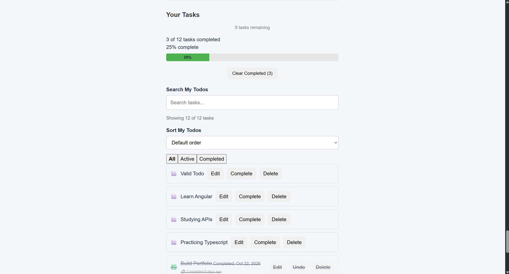
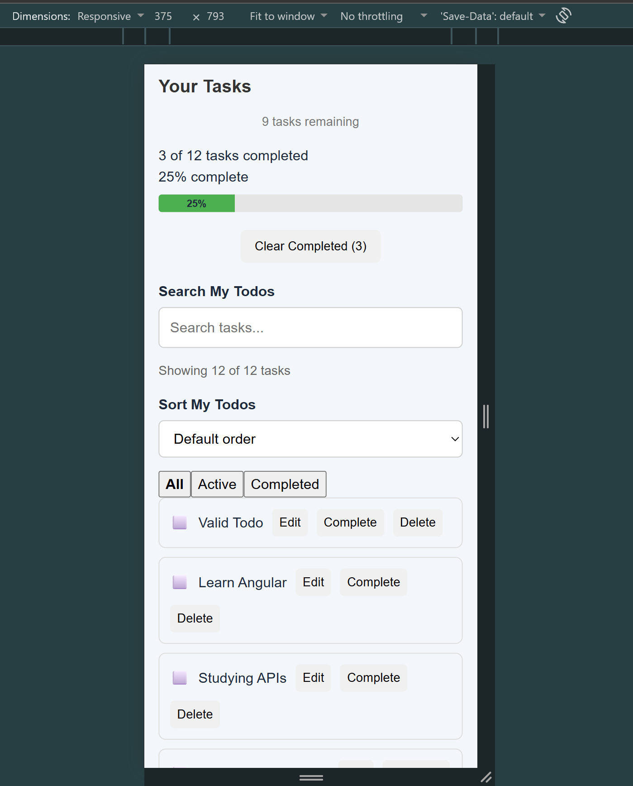

# Angular Todo List

A responsive task management application built with **Angular 19 and TypeScript**, featuring task management, search, filtering, sorting, localStorage persistence, REST API integration, and automated testing.

This project was developed as a hands-on learning experience focused on Angular application architecture, component communication, state management, asynchronous operations, and front-end testing.

## Features

### Task Management

- Add new tasks with input validation.
- Edit existing task titles.
- Mark tasks as completed or active.
- Delete individual tasks.
- Clear completed tasks with confirmation.
- Display relative completion information.
- Track active, completed, and total tasks.
- View task completion progress.

### Search, Filtering, and Sorting

- Search tasks by title.
- Filter tasks by All, Active, or Completed.
- Sort tasks using:
  - Default order
  - Title: A–Z
  - Title: Z–A
  - Active Tasks First
  - Completed Tasks First
- Reset sorting to the default order.
- Preserve the selected sorting preference using localStorage.
- Display helpful messages when no tasks match the current search or filter.

### REST API Integration

- Fetch sample Todo data from the JSONPlaceholder API.
- Display API Todos separately from locally managed tasks.
- Refresh API data.
- Display loading and error states.
- Retry eligible failed API requests.
- Handle network, not-found, and server errors.

### Responsive Design

- Responsive layout for desktop and mobile screens.
- Mobile-friendly task input controls.
- Flexible task cards and action buttons.
- Wrapping for long task titles.
- Accessible focus indicators for interactive controls.

## Technologies Used

| Technology     | Purpose                                      |
| -------------- | -------------------------------------------- |
| Angular 19     | Front-end framework                          |
| TypeScript 5.7 | Type-safe application development            |
| HTML5          | Application structure                        |
| CSS3           | Styling and responsive layouts               |
| RxJS 7.8       | Observables and asynchronous operations      |
| Angular Forms  | Form inputs and two-way binding              |
| HttpClient     | REST API requests                            |
| localStorage   | Browser-side task and preference persistence |
| Jasmine        | Unit and component testing                   |
| Karma          | Automated test execution                     |
| Git & GitHub   | Version control                              |

<!-- ## Screenshots

Screenshots will be added after the final visual review.

Suggested screenshots:

- Desktop application overview
- Mobile responsive layout
- Task management interface
- Search, filtering, and sorting controls -->

## Screenshots

### Desktop View



### Mobile View



## Getting Started

### Prerequisites

Install:

- Node.js, using a version compatible with Angular 19
- npm
- Git

### Installation

Clone the repository:

```bash
git clone <YOUR-REPOSITORY-URL>
```

Navigate into the project:

```bash
cd todo-list
```

Install dependencies:

```bash
npm install
```

### Run the Application

Start the development server:

```bash
npm start
```

Open:

```text
http://localhost:4200/
```

The application automatically reloads when source files change.

## Production Build

Generate a production build:

```bash
npm run build
```

The generated build files are placed inside the configured `dist/todo-list` output directory.

## Automated Testing

The project uses Jasmine and Karma for automated Angular testing.

Run the test suite:

```bash
npm test
```

Run all tests once without watch mode:

```bash
npm test -- --watch=false
```

Run only the Todo List component tests:

```bash
npx ng test --watch=false --include="src/app/components/todo-list/todo-list.component.spec.ts"
```

### Latest Verified Testing Results

- **187/187 automated tests passing**
- **115/115 TodoListComponent tests passing**
- Verified using Chrome 156 on Windows 10.
- Production build completed successfully.

The test suite includes component behavior, sorting, searching, filtering, persistence, service interactions, and regression testing.

## Application Architecture

The application separates responsibilities into Angular components, services, models, and utilities.

### Components

- **TodoInputComponent:** Handles task creation and input validation.
- **TodoListComponent:** Displays, searches, filters, and sorts tasks.
- **TodoItemComponent:** Handles individual task interactions.
- **ApiErrorComponent:** Displays API loading and error feedback.

### Service

- **TodoService:** Manages task data, localStorage persistence, and API integration.

### Models and Utilities

- TypeScript interfaces define Todo and API error data structures.
- Sorting and filtering types help constrain valid application states.
- Utility functions process tasks based on search, filter, and sorting options.

## Data Storage

Locally managed tasks are stored in the browser's localStorage.

The application restores saved tasks when the service initializes.

Sorting preferences are also saved and restored across application sessions.

The sample API Todos are fetched independently from the JSONPlaceholder API and are not the same as the user's locally managed tasks.

**Note:** localStorage data is browser-specific and is not synchronized between devices.

## Live Demo

Deployment URL: _To be added after deployment._

## Future Improvements

Potential improvements include:

- Improved mobile task-action layouts.
- Accessibility auditing and automated accessibility checks.
- End-to-end testing.
- Additional test coverage for network failures and edge cases.
- Further UI polish and performance improvements.

## Project Status

The original 177-lesson Angular To-Do List learning roadmap is complete.

The project has passed its latest automated testing and production build checks and is undergoing final portfolio documentation and deployment preparation.

## Developer

Developed by **Gemil Mejia**.

GitHub: https://github.com/gemilmejia

Portfolio: https://gemilmejia.github.io/portfolio

---

Built with Angular and TypeScript as a practical front-end development and software testing project.
